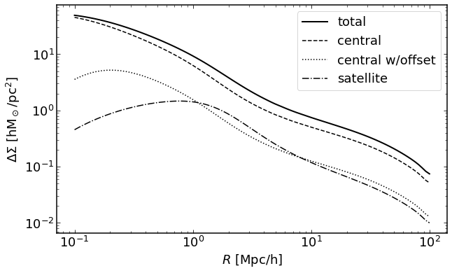
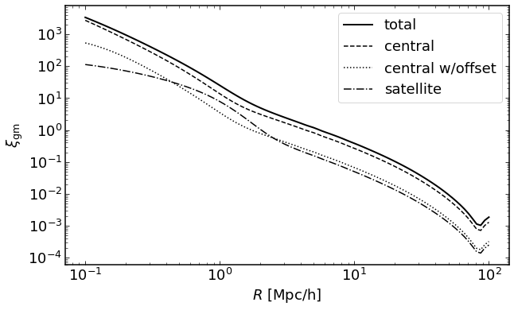
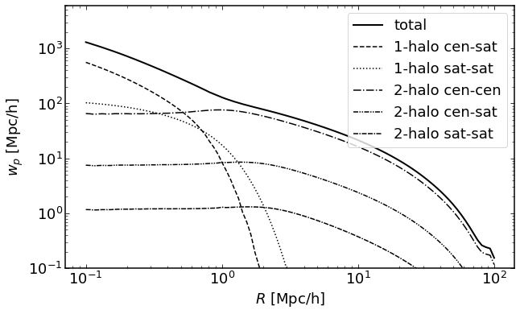
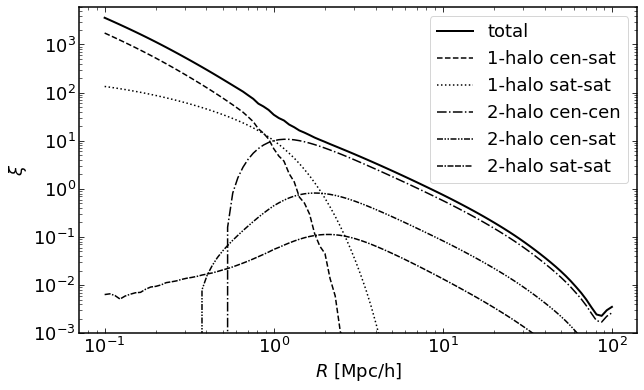
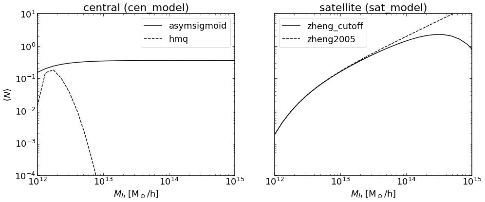
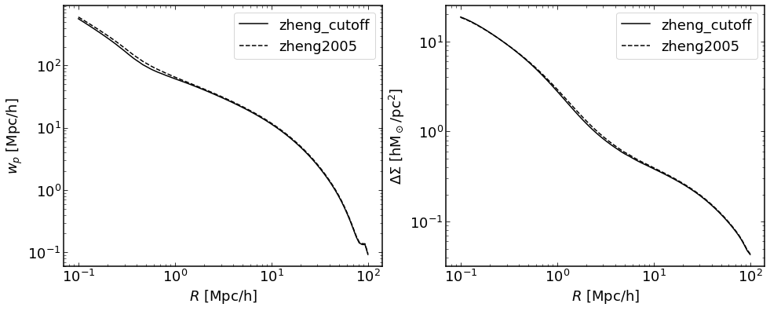

``model_hod`` module tutorial notebook
======================================

.. code:: ipython3

    %load_ext autoreload
    %autoreload 2
    %pylab inline
    import logging
    mpl_logger = logging.getLogger('matplotlib')
    mpl_logger.setLevel(logging.WARNING)
    pil_logger = logging.getLogger('PIL')

.. parsed-literal::

    Populating the interactive namespace from numpy and matplotlib

.. code:: ipython3

    plt.rcParams['font.family'] = 'sans-serif'
    plt.rcParams['font.size'] = 18
    plt.rcParams['axes.linewidth'] = 1.5
    plt.rcParams['xtick.major.size'] = 5
    plt.rcParams['ytick.major.size'] = 5
    plt.rcParams['xtick.minor.size'] = 3
    plt.rcParams['ytick.minor.size'] = 3
    plt.rcParams['xtick.top'] = True
    plt.rcParams['ytick.right'] = True
    plt.rcParams['xtick.minor.visible'] = True
    plt.rcParams['ytick.minor.visible'] = True
    plt.rcParams['xtick.direction'] = 'in'
    plt.rcParams['ytick.direction'] = 'in'
    plt.rcParams['figure.figsize'] = (10,6)

.. code:: ipython3

    from dark_emulator import model_hod

.. code:: ipython3

    hod = model_hod.darkemu_x_hod({"fft_num":8})

.. parsed-literal::

    initialize cosmo_class
    initialize xinl emulator
    Initialize pklin emulator
    initialize propagator emulator
    Initialize sigma_d emulator
    initialize cross-correlation emulator
    initialize auto-correlation emulator
    Initialize sigmaM emulator

how to set cosmology and galaxy parameters (HOD, off-centering, satellite distribution, and incompleteness)
-----------------------------------------------------------------------------------------------------------

.. code:: ipython3

    cparam = np.array([0.02225,0.1198,0.6844,3.094,0.9645,-1.])
    hod.set_cosmology(cparam)

    gparam = {"logMmin":13.13, "sigma_sq":0.22, "logM1": 14.21, "alpha": 1.13, "kappa": 1.25, # HOD parameters
               "poff": 0.2, "Roff": 0.1, # off-centering parameters p_off is the fraction of off-centered galaxies. Roff is the typical off-centered scale with respect to R200m.
               "sat_dist_type": "emulator", # satellite distribution. Chosse emulator of NFW. In the case of NFW, the c-M relation by Diemer & Kravtsov (2015) is assumed.
               "alpha_inc": 0.44, "logM_inc": 13.57} # incompleteness parameters. For details, see More et al. (2015)
    hod.set_galaxy(gparam)

.. parsed-literal::

    INFO:root:Got same cosmology. Keep quantities already computed.

how to plot g-g lensing signal in DeltaSigma(R)
-----------------------------------------------

.. code:: ipython3

    redshift = 0.55
    r = np.logspace(-1,2,100)

    plt.figure(figsize=(10,6))

    plt.loglog(r, hod.get_ds(r, redshift), linewidth = 2, color = "k", label = "total")
    plt.loglog(r, hod.get_ds_cen(r, redshift), "--", color = "k", label = "central")
    plt.loglog(r, hod.get_ds_cen_off(r, redshift), ":", color = "k", label = "central w/offset")
    plt.loglog(r, hod.get_ds_sat(r, redshift), "-.", color = "k", label = "satellite")

    plt.xlabel(r"$R$ [Mpc/h]")
    plt.ylabel(r"$\Delta\Sigma$ [hM$_\odot$/pc$^2$]")
    plt.legend()

.. parsed-literal::

    <matplotlib.legend.Legend at 0x7f8d07656b70>

how to plot g-g lensing signal in xi
------------------------------------

.. code:: ipython3

    redshift = 0.55
    r = np.logspace(-1,2,100)

    plt.figure(figsize=(10,6))

    plt.loglog(r, hod.get_xi_gm(r, redshift), linewidth = 2, color = "k", label = "total")
    plt.loglog(r, hod.get_xi_gm_cen(r, redshift), "--", color = "k", label = "central")
    plt.loglog(r, hod.get_xi_gm_cen_off(r, redshift), ":", color = "k", label = "central w/offset")
    plt.loglog(r, hod.get_xi_gm_sat(r, redshift), "-.", color = "k", label = "satellite")

    plt.xlabel(r"$R$ [Mpc/h]")
    plt.ylabel(r"$\xi_{\rm gm}$")
    plt.legend()

.. parsed-literal::

    <matplotlib.legend.Legend at 0x7f8d095bac50>

how to plot g-g clustering signal in wp
---------------------------------------

.. code:: ipython3

    redshift = 0.55
    rs = np.logspace(-1,2,100)

    plt.figure(figsize=(10,6))

    plt.loglog(r, hod.get_wp(r, redshift), linewidth = 2, color = "k", label = "total")
    plt.loglog(r, hod.get_wp_1hcs(r, redshift), "--", color = "k", label = "1-halo cen-sat")
    plt.loglog(r, hod.get_wp_1hss(r, redshift), ":", color = "k", label = "1-halo sat-sat")
    plt.loglog(r, hod.get_wp_2hcc(r, redshift), "-.", color = "k", label = "2-halo cen-cen")
    plt.loglog(r, hod.get_wp_2hcs(r, redshift), dashes=[4,1,1,1,1,1], color = "k", label = "2-halo cen-sat")
    plt.loglog(r, hod.get_wp_2hss(r, redshift), dashes=[4,1,1,1,4,1], color = "k", label = "2-halo sat-sat")

    plt.xlabel(r"$R$ [Mpc/h]")
    plt.ylabel(r"$w_p$ [Mpc/h]")
    plt.legend()
    plt.ylim(0.1, 6e3)

.. parsed-literal::

    (0.1, 6000.0)

how to plot g-g clustering signal in xi
---------------------------------------

.. code:: ipython3

    redshift = 0.55
    rs = np.logspace(-1,2,100)

    plt.figure(figsize=(10,6))

    plt.loglog(r, hod.get_xi_gg(r, redshift), linewidth = 2, color = "k", label = "total")
    plt.loglog(r, hod.get_xi_gg_1hcs(r, redshift), "--", color = "k", label = "1-halo cen-sat")
    plt.loglog(r, hod.get_xi_gg_1hss(r, redshift), ":", color = "k", label = "1-halo sat-sat")
    plt.loglog(r, hod.get_xi_gg_2hcc(r, redshift), "-.", color = "k", label = "2-halo cen-cen")
    plt.loglog(r, hod.get_xi_gg_2hcs(r, redshift), dashes=[4,1,1,1,1,1], color = "k", label = "2-halo cen-sat")
    plt.loglog(r, hod.get_xi_gg_2hss(r, redshift), dashes=[4,1,1,1,4,1], color = "k", label = "2-halo sat-sat")

    plt.xlabel(r"$R$ [Mpc/h]")
    plt.ylabel(r"$\xi$")
    plt.legend()
    plt.ylim(1e-3, 6e3)

.. parsed-literal::

    (0.001, 6000.0)

how to use an HOD with independent central and satellite occupations (e.g., ELG-like samples)
---------------------------------------------------------------------------------------------

The default HOD (``hod_type="standard"``) conditions satellites on centrals, :math:`\langle N_\mathrm{sat}\rangle = \langle N_\mathrm{cen}\rangle\,\lambda_\mathrm{sat}`, so that :math:`\langle N_\mathrm{cen}N_\mathrm{sat}\rangle = \langle N_\mathrm{sat}\rangle`. For samples whose central occupation does not reach unity, such as emission-line galaxies, it is more natural to treat the two occupations as independent. Setting ``hod_type="independent"`` uses :math:`\langle N_\mathrm{cen}N_\mathrm{sat}\rangle = \langle N_\mathrm{cen}\rangle\langle N_\mathrm{sat}\rangle` and :math:`\langle N_\mathrm{sat}(N_\mathrm{sat}-1)\rangle = \langle N_\mathrm{sat}\rangle^2` in the 1-halo terms, and lets you choose the functional forms of both occupations.

Central occupation, ``cen_model``:

- ``"hmq"`` (default): modified HMQ, :math:`\langle N_\mathrm{cen}\rangle = \frac{2p_\mathrm{max}}{\sqrt{2\pi}\sigma_M}\exp\left[-\frac{(\log M_h-\log M_c)^2}{2\sigma_M^2}\right]\frac{1}{2}\left[1+\mathrm{erf}\left(\frac{\gamma(\log M_h-\log M_c)}{\sqrt{2}\sigma_M}\right)\right]`. Parameters: ``p_max``, ``sigma_M``, ``logMc``, ``gamma``.
- ``"asymsigmoid"``: asymmetric sigmoid (`Linde et al. 2026 <https://arxiv.org/abs/2605.21436>`__, Eq. 42), :math:`\langle N_\mathrm{cen}\rangle = f_\mathrm{max}\left\{1+\left[C(a,b)\frac{\log M_\mathrm{min}}{\log M_h}\right]^{1/a}\right\}^{-1/b}` with :math:`C(a,b)=(2^b-1)^a`, so that :math:`\langle N_\mathrm{cen}(M_\mathrm{min})\rangle = f_\mathrm{max}/2`. Parameters: ``f_max``, ``logMmin``, ``a``, ``b``.

Satellite occupation, ``sat_model``:

- ``"zheng_cutoff"`` (default): :math:`\langle N_\mathrm{sat}\rangle = A_s (M_h/M_1)^\alpha \exp(-M_\mathrm{cut}/M_h)\exp(-M_h/M_\mathrm{max})`. Parameters: ``A_s``, ``logM1``, ``alpha``, ``logMcut``, ``logMmax``.
- ``"zheng2005"``: :math:`\langle N_\mathrm{sat}\rangle = A_s (M_h/M_1)^\alpha \exp(-M_\mathrm{cut}/M_h)`. Parameters: ``A_s``, ``logM1``, ``alpha``, ``logMcut``.

All masses are in :math:`h^{-1}M_\odot` and are given as :math:`\log_{10}`. The off-centering and satellite-distribution keys (``poff``, ``Roff``, ``sat_dist_type``) are required as in the standard HOD, and the incompleteness keys (``alpha_inc``, ``logM_inc``) remain optional. ``set_galaxy`` raises a ``ValueError`` naming any missing parameter, so a forgotten key is never replaced by a default value.

The parameter values below are for illustration only. After the HOD has been evaluated (e.g., by ``get_ng``), the occupations are available as ``hod.Ncen`` and ``hod.Nsat`` on the halo-mass integration grid ``hod.Mh``, which spans ``M_int_logMmin`` to ``M_int_logMmax`` in the ``config`` of ``darkemu_x_hod``.

.. code:: ipython3

    redshift = 1.0

    # fiducial independent HOD: asymsigmoid central + zheng_cutoff satellite
    gparam_indep = {"hod_type": "independent",
                    # central occupation
                    "cen_model": "asymsigmoid", "f_max": 0.36, "logMmin": 12.07, "a": 0.027, "b": 1e-8,
                    # satellite occupation (logMmax is used only by sat_model="zheng_cutoff")
                    "sat_model": "zheng_cutoff",
                    "A_s": 0.6, "logM1": 13.46, "alpha": 0.98, "logMcut": 12.4, "logMmax": 14.5,
                    # off-centering and satellite distribution, as in the standard HOD
                    "poff": 0.0, "Roff": 0.0, "sat_dist_type": "emulator"}

    # the same HOD with the modified HMQ central instead (extra keys of the other model are ignored)
    gparam_hmq = {**gparam_indep, "cen_model": "hmq", "p_max": 0.06, "sigma_M": 0.2, "logMc": 12.1, "gamma": 3.0}

    sat_models = ["zheng_cutoff", "zheng2005"]
    styles = {"zheng_cutoff": "-", "zheng2005": "--"}

    fig, axes = plt.subplots(1, 2, figsize=(16,6), sharey=True)

    # left: central occupation for each cen_model
    for gparam, ls in [(gparam_indep, "-"), (gparam_hmq, "--")]:
        hod.set_galaxy(gparam)
        hod.get_ng(redshift)  # evaluates the HOD
        axes[0].loglog(hod.Mh, hod.Ncen, ls, color = "k", label = gparam["cen_model"])

    # right: satellite occupation for each sat_model
    for sat_model in sat_models:
        hod.set_galaxy({**gparam_indep, "sat_model": sat_model})
        ng = hod.get_ng(redshift)
        fsat = 1. - hod.get_ng_cen(redshift)/ng
        print(f"{sat_model:13s}: n_g = {ng:.3e} (h/Mpc)^3, f_sat = {fsat:.3f}")
        axes[1].loglog(hod.Mh, hod.Nsat, styles[sat_model], color = "k", label = sat_model)

    axes[0].set_title("central (cen_model)")
    axes[1].set_title("satellite (sat_model)")
    axes[0].set_ylabel(r"$\langle N \rangle$")
    for ax in axes:
        ax.set_xlabel(r"$M_h$ [M$_\odot$/h]")
        ax.set_xlim(1e12, 1e15)
        ax.legend()
    axes[0].set_ylim(1e-4, 10)

.. parsed-literal::

    zheng_cutoff : n_g = 1.134e-03 (h/Mpc)^3, f_sat = 0.156
    zheng2005    : n_g = 1.149e-03 (h/Mpc)^3, f_sat = 0.167

.. parsed-literal::

    (0.0001, 10)

The observables are computed exactly as for the standard HOD. Here we compare :math:`w_p` and :math:`\Delta\Sigma` for the two satellite models.

.. code:: ipython3

    r = np.logspace(-1,2,100)

    fig, axes = plt.subplots(1, 2, figsize=(16,6))
    for sat_model in sat_models:
        hod.set_galaxy({**gparam_indep, "sat_model": sat_model})
        axes[0].loglog(r, hod.get_wp(r, redshift), styles[sat_model], color = "k", label = sat_model)
        axes[1].loglog(r, hod.get_ds(r, redshift), styles[sat_model], color = "k", label = sat_model)

    axes[0].set_xlabel(r"$R$ [Mpc/h]")
    axes[0].set_ylabel(r"$w_p$ [Mpc/h]")
    axes[1].set_xlabel(r"$R$ [Mpc/h]")
    axes[1].set_ylabel(r"$\Delta\Sigma$ [hM$_\odot$/pc$^2$]")
    axes[0].legend()
    axes[1].legend()

.. parsed-literal::

    <matplotlib.legend.Legend object at 0x154113207100>

